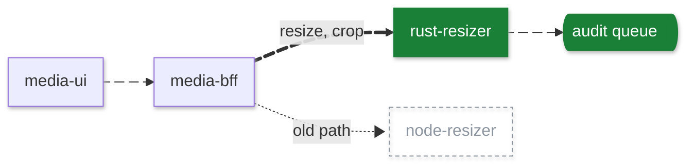

# Writing PR descriptions

A PR description is a reviewer's first five minutes. Show the change as a picture when the change has a shape, then explain it in short, plain sentences. Every mark on the diagram must mean something.

## 1. Gate: does this change earn a diagram?

Draw one when **any** of these is true:
- The change crosses a boundary between two or more services, apps, libs or modules.
- It changes a data flow, a call order, a state machine, or an API contract.
- It adds, removes or re-routes a dependency between parts.
- It changes UI internals: state, selectors, sagas, effects, API calls, routing. Many UI changes are not visual; treat these as data flow.
- It changes a package: a minor or major dependency bump, or a change to a shared lib that other apps consume.

These rules win. Write text only when **none** of them is true. A one-file change to an API contract, or a flag flip that changes a rollout state, still gets a diagram. Changes that usually match none of them: copy, formatting, renames, tests-only, docs-only, reverts, patch bumps with no API or behaviour change, and purely visual UI changes (offer a UI recording instead, section 6).

Build the diagram from the diff you already know. Do not read more files or spawn agents to draw it.

## 2. The diagram

Use current Mermaid syntax (every form below parses on 12.1.0). **Max 12 nodes.** Show only the parts the change touches, plus one neighbour each side for context. Pick the type that shows the change best:

| The change is about | Diagram |
|---|---|
| A data flow or a dependency between parts | `flowchart` (default) |
| Call order, retries, async hand-offs | `sequenceDiagram` |
| UI state, a lifecycle, a flag rollout, a saga | `stateDiagram-v2` |
| Service or infrastructure topology | `architecture-beta` |
| A package: what it changes for its consumers | see "Package changes" below |

Colour encodes, never decorates - one meaning per colour, always:



- `added` green, `changed` amber, `removed` grey dashed. Unchanged nodes keep the default style. These fills read in GitHub light and dark mode. When every node is new (a new tool or skill), use no colour.
- **Colour says what changed. Motion shows one journey.** Pick the one request or event the PR is about (a resize, a Merge click) and animate every edge it travels after the change, from its entry point to its result, unchanged hops included. A moving line that starts or stops in the middle of a route reads as random. Give each edge an id (`eN@`) and `eN@{ animation: fast }`. Use `slow` only for the async or background part of the same journey (a queue, a job). Never animate a removed path, an edge the journey does not take, or more than one journey.
- When the journey branches, animate the branch the PR changes; animate both only when both are new behaviour.
- **Shapes carry type:** `cyl` database, `h-cyl` queue or stream, `doc` file or config, `cloud` external service, `stadium` user entry point. Plain rectangles for code.
- **Look:** start every diagram with the `look: neo` frontmatter. Use `handDrawn` only for a rough proposal or a spike PR.
- In a `sequenceDiagram`, wrap the new steps in `rect rgba(26,127,55,0.15)` ... `end`. It has no classes or animation.
- `architecture-beta` has no classes or animation. Mark new or removed parts in their labels ("audit queue (new)"), and use it only when the topology itself is the point.
- Label edges sparingly: a verb or a payload, 1-3 words.
- `accTitle:` is the alt text. Write it as the one-line "what changes".
- When the change re-routes a flow, a before/after pair is clearer than one busy picture: show "After" open, put "Before" in `<details>`.
- Syntax safety: quote any label with `()`, `:` or `/` as `A["label (x)"]`; never use `end` as a node id; one statement per line; declare a shaped node (`X@{ shape: ... }`) on its own line before its edges; apply classes to shaped nodes with `class X name`, not `:::`.

Below the diagram, write one legend line whenever colour or motion is used, and name the journey in it: `Moving line: the path a resize takes now (slow part: async). Green = new. Grey dashed = the old path.`

### Package changes

Show what the package changes for the code that uses it, not the package's insides. Pick one:
- **Blast radius:** a `flowchart` with the package in the centre and its consumers around it. Colour each consumer by impact: `changed` for code you had to edit, default for no change needed.
- **API delta:** a `classDiagram` with a `Before` and an `After` class for the export that changed, side by side. Style `After` as `changed`; Mermaid cannot style single members.
- **Behaviour delta:** a before/after `flowchart` of the one behaviour that changed (for example, a retry, a default or a render path).

If no form fits, invent one that shows the consumer's view. Keep the 12-node cap.

### Unsupported on GitHub

GitHub sets its own Mermaid version. If a live PR shows a Mermaid error, remove the feature that caused it from that PR, then add it to this list so later diagrams do not use it:

- (none found: every form in this skill rendered on GitHub on 2026-10-07)

## 3. The text: about 80% ASD-STE100

Fill the repo's PR template if it has one, with the Design part and the diagram after the summary. Otherwise use this shape:

1. **Summary** - one sentence, max 20 words: what changes and why.
2. **Design** - for every PR that earns a diagram and every visible UI change; not for mechanical PRs (renames, bumps, formatting). Three parts:
   - **Decision:** the approach taken, in one sentence.
   - **Not chosen:** at most 3 options you actually weighed, each with the one reason it lost. Never pad this with straw men; if there was no real alternative, leave the part out.
   - **You are judging:** what a person must decide, not what CI or a type checker already proves ("is a 2 s retry long enough for users", not "does it compile").
3. **Diagram** (if the gate passed).
4. **Why** - 1-3 sentences. Include the one number that matters, if there is one ("3 calls become 1").
5. **Changes** - max 6 bullets, one line each, grouped by area.
6. **Testing** - what you ran and what you saw. If you ran nothing, say so. A UI recording and a design receipt go here (section 6).
7. **Risk and rollback** - 1-2 lines. Put them in a `> [!WARNING]` box only when the change is live on deploy with no flag, or has a data migration or contract change. Otherwise use a plain line.
8. **Start here** - the one file a reviewer should read first.

STE rules to apply:
- One idea per sentence. Max 20 words for steps, 25 for descriptions.
- Active voice. Present, past or simple future tense.
- One word, one meaning: "use" not "utilise", "start" not "initiate", "do" not "perform", "make sure" not "ensure".
- Keep articles ("the", "a"). Do not stack more than three nouns.
- Max 6 sentences per paragraph. Use lists for sequences.
- The 20% allowance: code identifiers, standard software terms (roll back, merge, flag), and an "-ing" form where the rewrite reads worse.

## 4. Slack DM for a tick or approval

Run `gh pr view <n> --json url,title` for the link. Write the DM at about 50% STE: lead with the ask, then what changes, then anything the reader must know. Max about 60 words. No diagram or text sketch: the PR link carries the diagram.

```
Hi, can you give this a tick? [the PR](url)
It moves resize and crop to rust-resizer, behind a flag.
Flag is off in prod. No user change until we turn it on.
```

Keep the details that change the reader's decision (flag state, risk, deadline). Cut background, thanks paragraphs and restated PR text.

## 5. Change reel (video)

A reel is a short narrated video, with music, that explains what changed and why as motion design: kinetic type, the mechanism running, the real hunk, the reviewer's check. It does not replay the diagram. Claude writes each beat as a HyperFrames composition; the build voices the script, times every frame to the voice and renders 1920x1080 at 30 fps. Everything runs on this machine. Never run `hyperframes publish`, `cloud`, `lambda`, `cloudrun`, `auth`, `usage`, `catalog`, `add`, `skills` or `preview`, and never send PR content to a hosted voice, music or video service.

**When:** the diagram gate passed and the change is medium or complex (three or more parts touched, a re-route, or a state or contract change). Also make one whenever someone asks for a reel. A simple diagram change gets no reel.

**Who writes it:** you, on Opus. A reel is creative work: never hand the script, the storyboard or the frames to a Haiku subagent. If the session is pinned to another model, write the reel in an Opus subagent.

**Set-up** (once per machine), from this skill's folder:

```bash
node reel/setup.mjs --check   # JSON: status ok | needs_action, with actions
node reel/setup.mjs           # installs what is missing, all local
node reel/setup.mjs --qwen-voices      # recommended: Qwen3-TTS voices, about 6.5 GB more
node reel/setup.mjs --natural-voices   # optional fallback: Chatterbox-Turbo voices, about 3.5 GB more
```

Set-up also clones HyperFrames' own skills and block registry (Apache-2.0, about 106 MB) to `~/.cache/pr-reel/hyperframes-src`, called `$HF` below, at the tag of the installed CLI. Builds copy blocks and frame presets from there and fetch nothing. The craft documents are vendored in this skill at `references/hyperframes/`, called `$REF` below (Apache-2.0, unmodified from v0.8.138, see its `NOTICE.md`), because later HyperFrames releases delete most of them.

Builds pick the best engine installed: Qwen3-TTS 0.6B (Apache-2.0), then Chatterbox-Turbo (MIT), then Kokoro. `REEL_TTS=qwen`, `chatterbox`, `kokoro` or `http` picks one. Qwen3-TTS and Chatterbox clone their timbre from a synthetic Kokoro clip per voice name, so no real person is cloned, and both run offline after set-up (about 30 s a line on CPU). Both read spelling, not phonemes, so the build spells acronyms as letters ("A.P.I."), lowercases shouted words ("RESIZED") and splits `userId` and `rust-resizer`. A local Whisper checks every take against the script, re-takes misheard lines, and records when each word is spoken; frames reveal on those timings. `reel: check pronunciation` means three takes still missed. For every engine, the build also respells words that are spelt one way and said two ways, from the sentence: "it was read" and "the saga read" say *red*, "to read", "please read" and "read-only" say *reed*. For a word it still gets wrong, give the line a `speak` (what the voice says) beside its `say` (the caption); `speak` is voiced exactly as written. With Kokoro, word timings are estimated from word length.

`REEL_TTS=http` uses a speech server on this machine with an OpenAI-style `POST /v1/audio/speech` (default `http://127.0.0.1:3900/v1/audio/speech`). Set `REEL_TTS_URL`, `REEL_TTS_MODEL` and `REEL_TTS_VOICES` (JSON, our voice name to the server's) as needed. The build refuses any host that is not loopback. Pick a model with MIT, Apache-2.0 or CC-BY-4.0 weights;

If `status` is not `ok`, show the `actions` and stop. Uploading video needs `gh` 2.99.0 or later (`--attach`); the check probes the flag and prints the upgrade command for the OS.

**Read the HyperFrames references before you write.** They are the motion-design craft the reel is built on. Read them; do not run their workflows.

| Read | For |
|---|---|
| `$REF/skills/pr-to-video/references/story-design.md` | The archetype (changelog, feature reveal, fix explainer, refactor walkthrough), the hook and the beats |
| `$REF/skills/pr-to-video/references/motion-language.md` | The move vocabulary and the motion doctrine. Load-bearing |
| `$REF/skills/pr-to-video/references/visual-design.md` and `cut-catalog.md` | Shot sequences, layout, and cuts inside a frame |
| `$REF/skills/pr-to-video/references/code-vocabulary.md` | Which `code-*` block shows which code beat, and how to show behaviour |
| `$REF/skills/hyperframes-animation/blueprints-index.md`, then `blueprints/<id>.md` and `rules/<id>.md` | The shot shape and the recipe for each move you use |
| `$REF/skills/hyperframes-animation/transitions/catalog.md` | What each transition means |
| `$HF/skills/hyperframes-creative/frame-presets/<name>/FRAME.md` | The design system for this reel (13 presets) |
| `$REF/skills/hyperframes-core/references/sub-compositions.md` and `determinism-rules.md` | The frame file contract |
| `$HF/registry/blocks/*/registry-item.json` | The 173 blocks. Search them with Grep, not `hyperframes catalog` (that is hosted) |
| `reel/PITFALLS.md` | Mistakes frames are written against. Read it before the first frame |

These skills are written for HyperFrames' own pipeline. Borrow their taste and rules, not their steps: skip the intent interview, `BRIEF.md`, HeyGen voices and music, media-use, avatar downloads, frame workers and their CLI commands. This build owns audio, timing, assembly and render.

**Write `reel.json` and the frames** beside the PR body. `reel/examples/frames/` is the reference reel (the forwarding-sticker world in the diorama design), and `lit.html` in it is the reference lit 3D frame: copy their file shapes, never their world, design or story.

1. **Story.** Pick the archetype from `story-design.md`. Size the reel from the diff (`gh pr view <n> --json additions,deletions,changedFiles`): up to about 50 changed lines, 20-30 s; up to about 200, 30-45 s; more, 45-60 s. Never more than 60 s. Voices run at about 2.4 words a second. The tier is a ceiling: a one-idea change gets a short reel.
2. **Storyboard.** Before any HTML, list the scenes: the beat, the blueprint id, the moves (with rule ids), which element reveals on which spoken word, and the transition in. Keep it in your reply or a scratch file; it is not committed.
3. **World, telling and design: deal them, every reel.** Name the change pattern from the diff (`reroute`, `gate`, `validate`, `translate`, `cache`, `retry`, `queue`, `migrate` and others), then run `node reel/pick-scenario.mjs --pattern <pattern> --seed "$PR"` (add `--humour` for a humour reel). It deals three candidates from 71 everyday worlds (a forwarding sticker on a letter, a baggage carousel, railway points...), 12 tellings and 25 designs, and skips the worlds and designs of the last reels built on this machine. Pick the candidate whose mapping is exact for this diff, or invent a better world. Record it as `"scenario": { "world": "...", "telling": "...", "design": "..." }` in `reel.json`; the build logs it so the next deal moves on.
   - **Draw the world, not the system.** The PR body already has the diagram. A reel's frames show the world (the letter, the sticker, the sorting desk), with its parts labelled by the real component names so the mapping stays exact. A boxes-and-arrows diagram of services is not a world. The `code` beat, the reviewer's check and the close are the only frames that leave the world.
   - **Design:** a `look` design carries one of the 12 looks into the frame (follow its `design_brief` and `fonts`, and set `look` to the same id so captions match). A `preset` design is a HyperFrames preset: follow its `FRAME.md` atoms exactly (palette, type, rules, signatures). The composition is yours either way.
4. **Frames.** One `frame` scene per beat, each with its own HTML file. Most beats carry two or three reveals per spoken line. Put real effort into the art: drawn diagrams, texture, typographic hierarchy, props. Plain boxes and arrows are the floor, not the target.
5. **Close** on the reviewer's check as the last spoken line, then a closing frame or a built-in `card`.

**A frame file** is a HyperFrames sub-composition (see `reel/examples/frames/letter.html`):
- Everything goes inside `<template>`. The root is `<div id="root" class="f-<id>" data-composition-id="<id>" data-width="1920" data-height="1080">`, where `<id>` is the scene's `id`. Style the root by `#root` and nothing else on it.
- The stage, other frames and blocks share one page. Prefix every class with the frame's own short prefix (`rt-node`, not `node`), find elements from your root (`document.querySelector('.f-<id>')`), and pass elements to GSAP, never selector strings.
- Build one paused `gsap.timeline()` and register it as `window.__timelines['<id>']`. Extend it to `F.duration`.
- `var F = window.__REEL['<id>']` holds `duration`, `end` (when the beat's content ends, before the next transition), and `lines` (`say`, `start`, `len`, `words`), all in seconds from the frame's own start. `F.cue(line, 'word')` returns when that word is spoken (`F.cue(line, 'word', true)` when it ends). Reveal each element on the word that names it.
- Motion doctrine, from `motion-language.md`: `power3` long-tail eases, no bounce or overshoot; reveal in sequence with the voice, never everything in the first quarter; no breathing loops and no slow drift; `fromTo` for every entrance; no CSS animation or transition, no `Math.random`, `Date.now`, `repeat` or `yoyo`. The transition into the next scene is the exit; only the last frame animates out.
- The stage draws karaoke captions at the bottom. Keep content above y = 900, or set `"captions": false` on the scene and show the words yourself.
- Name any Google font by family; HyperFrames downloads each face once by its name and caches it, so only the family name leaves the machine. Nothing else may load from the network: no CDN scripts, remote images or remote CSS. The build refuses them. Draw art as inline SVG, canvas or a lit 3D scene.

**Lit 3D world frames.** World frames in the `studio`, `diorama`, `paper` and `iso` looks are lit 3D scenes: real light, cast shadows and physically based materials from the renderer, not gradients faked by hand. The flat looks (`blueprint`, `ink`, `notebook`, `whiteboard`, `riso`, `terminal`, `infographic`, `dusk`) and every HyperFrames preset stay 2D. The code beat, the check and the close stay 2D in every look. `reel/examples/frames/lit.html` is the reference (`reel/examples/lit.json` builds it):
- **Engine.** Name `THREE_MODERN` in the frame and the build loads it (unpatched three r187, with `RoomEnvironment` and `RoundedBoxGeometry`) and `reel/lit.js` as `window.LIT`. Never use `THREE` in a frame: that is the r147-patched copy for registry blocks.
- **Rig.** `LIT.stage(root, opts)` makes the renderer (antialias, `preserveDrawingBuffer: true`, pixel ratio 1, 1920x1080, ACES filmic at exposure about 1, soft shadows), image-based light from `RoomEnvironment` at `env` 0.35-0.45, and fog for depth. `LIT.rig(st)` adds a warm shadow-casting key spot, a cool rim and a low hemisphere fill. Carry the look's palette into the light colours, the fog and the materials, and its fonts into every label.
- **Materials.** `LIT.mat.metal` (metalness 1, roughness 0.2-0.3, light clearcoat), `lacquer` (painted or lacquered wood, clearcoat 0.55-0.8), `matte`, and `glass` (a faint clearcoat sheet; never `transmission`, which hazes what sits behind it). Build geometry from primitives and `LatheGeometry`; load no models. Draw wood, brick, paper and dial textures on canvases with `LIT.texture` and its seeded `rnd`, so every render is the same.
- **Text.** A label that sits in the world and takes its light is a canvas texture (`LIT.texture`, which repaints after `document.fonts.ready`). An annotation is an HTML element pinned to a 3D point with `LIT.anchor`, placed again on every paint.
- **Time.** The whole 3D state is a pure function `draw(t)`, eased inside with `LIT.span(t, a, b, ease)`. `LIT.drive(tl, st, draw, F.duration)` runs it from one driver tween's property setter, because a seek fires no `onUpdate`. HTML reveals stay ordinary `fromTo` tweens.
- **Camera.** One push or one pull per beat, eased over the beat. No orbits, no shake, no second move. `iso` uses `camera: { ortho }` for its parallel view.
- Rendering uses WebGL. Chrome uses the GPU when it has one and falls back to software rendering, which is slower but draws the same.

**Blocks.** A frame scene's `blocks` mounts registry blocks above the frame. For a `code-*` block, give `states` (the real code before and after, quoted from the diff; the build bakes the syntax colours locally with Shiki), `lang` and `file`. `box` is `[x, y, width]` in 1920x1080 pixels to inset the block; `at` and `until` are `[line, fraction]`. For any other block (`flowchart`, `data-chart` and the rest), copy its HTML from `$HF/registry/blocks/<name>/` beside `reel.json`, edit its content, and give `src`. Fit the block's own timing to its window (`code-vocabulary.md`, "Gotchas").

**Transitions.** A scene's `transition` is how it arrives: `cut` (default), `push`, `push-up`, `wipe`, `iris`, `blinds`, `blur`, `zoom`, `light-leak`, `dip` or `glitch`, with an optional `transitionLen` (0.2-1.5 s, default 0.6). Choose by meaning: `push` for the next step, `wipe` for a reveal, `iris` for focus, `blur` or `zoom` for a change of level, `dip` for a chapter break, `glitch` for a failure. Use two or three kinds in a reel, not one everywhere and not a different one each time.

**Principles behind every reel.** These people inform how a reel explains, not how it looks. Never imitate their drawings:
- **Ramón y Cajal:** draw what you actually observed in the diff, and always show which way things flow.
- **Grant Sanderson:** build intuition before formality; let one representation transform into the next; keep one colour per idea for the whole reel.
- **David McCandless:** colour and size must encode something true; make the data beautiful by making it clear.
- **Richard Feynman:** the simplest true explanation, with one everyday analogy.
- **John Hattie:** say what the viewer will understand, and end with what success looks like (the reviewer's check).
- **Andrej Karpathy:** show the real thing (the actual call, the real hunk), built up step by step.
- **Henry Reich:** draw while you explain; reveal each piece as the voice reaches it.
- **Leonardo:** curiosity and cutaways; show the inside of the machine, annotated.

**Top-level fields:** `title`, `pr` (optional: a chip naming the repo and PR), `music` (see below), `coldOpen` (default `true`: the built-in hook card that shows `hook`, 3-7 words of outcome language; set `false` when the first frame is the cold open), `chapters` (`false` hides the progress ticks), `look` (the built-in scenes' style and the caption colours), `seed` and `tone`.

**Music.** Prefer a procedural bed: `"music": { "style": "jazz" }` (soft corporate jazz), `"lofi"`, `"garage"` (soft future garage), `"fighter"` (a Matrix-style arcade fight: galloping double kick, power-chord riff, square-wave arpeggios), `"rocksteady"` (one-drop drums, a melodic bass, a guitar skank, a melodica or organ lead), `"rumba"` (Congolese rumba: clave, congas and sweet guitars in thirds, then a sebene with a high guitar ostinato over the cavacha), `"powermetal"` (double kick, palm-muted power chords, a choir, a twin-guitar lead), `"deephouse"` (four on the floor, minor-ninth chords, a warm sub, a vocal-chop or Rhodes lead) or `"techno"` (a hard kick over a rumble, with an acid line or dub stabs). `music_procedural.py` writes it from code in a few seconds, to the reel's exact length; there is no model and nothing to download. The seed (default: the `pr` value) picks the key, tempo, progressions, form, groove, fills, lead voice and the lead's motif, so every PR gets its own piece; inside a piece the groove changes only at phrase and section ends. Every hit sits on the beat grid: a scene cut gets a cymbal on the nearest beat when that beat falls inside the cut's sync window (wider for a dissolve than for a hard `cut`), otherwise a soft swell rises into it. Optional `bpm` (60-180). Pick the style for the story: jazz for a calm feature or walkthrough, lo-fi for a small fix or refactor, rocksteady for a relaxed tidy-up or a dependency bump, rumba for a cheerful user-facing win, garage for a big re-route or a performance change, deep house for a steady pipeline or infrastructure change, techno for automation, CI or a background job, power metal for a big migration or launch, fighter for a humour reel, a showdown between two paths, or a fix that beats a long-running bug. A MusicGen prompt string still works, but it takes minutes and sounds generic: write a fresh prompt for each reel, never reuse one.

**The script:**
- Every line must be true to the diff. Quote real code; invent jokes, never facts. Do not claim a hop, endpoint or version you have not seen in the diff.
- Value before evidence: the user-facing payoff lands in the hook and the first scene; code is the evidence.
- Speak like an engineer briefing a reviewer: the change, the condition, what is unchanged, and what to check. Plain spoken English, short sentences, active voice, about 20 words a sentence at most. A phrase of colour is fine when it carries a fact.
- Mood beats are allowed: a frame with no `lines` (give it `hold` seconds) can open the reel or bridge two beats with kinetic type, one image of the change and the music. A mood beat makes no claim the hook does not already make.
- A flag, a config value or a setting is never a character and never speaks. It is a toggle the team uses: "turn the flag off", not "flip me back". Personify services only, and only when the device calls for it.
- Every beat has a job: it changes what the viewer understands, moves the request along, or raises the stakes.
- The last spoken line names the reviewer's check (for example: flag off, crop unchanged, error toasts).
- Concrete over vague: say "a 40 MB upload is still refused", not "robust". Never use "seamless", "robust", "powerful", "simply", "just" or "leverage".
- Flag defaults, rollout order ("X is next") and "identical" or "same message" claims need a line in the diff or the PR body; otherwise cut them or soften them. On-screen labels must not contradict what is said.
- Never read numbers, paths or identifiers aloud. Put them on screen and say what they mean.
- No customer data. Personas are generic ("A photographer"), never a real person or organisation.
- Give each actor its own voice. British: `bf_emma`, `bf_isabella`, `bm_george`. American: `af_nova`, `af_heart`, `am_adam`, `am_michael`.
- Every sound effect sits on something the viewer sees happen: an item landing, a toggle moving, a tick drawing. Give a line `"sfx": [{ "name": "pop", "word": "BFF", "offset": 0.3 }]` to land it on a spoken word, or `"at"` (a fraction of the line). Small: `pop`, `click`, `click-soft`, `ping`, `typing`, `key-press`, `whoosh-short`, `glitch`, `error`. Big (they fill the room): `chime`, `sparkle`, `notification`, `riser`, `impact-bass`, `whoosh-cinematic`. A scene that arrives by `push`, `push-up`, `wipe`, `blinds`, `zoom` or `blur` gets a short whoosh automatically and `glitch` a glitch; a `cut`, `dip`, `iris` or `light-leak` stays dry, because the procedural bed already marks cuts on the beat.
- **The effect budget.** Fewer, better-placed effects. The build drops any cue that breaks a rule, logs it (`reel: dropped sfx ...`), and places a line's own cues before automatic ones: the same small effect twice within 1.2 s (except `ping`, whose repeats step through the chord, for a run of ticks), the same big effect within 8 s, more than 3 effects in 2 s, more than one big effect in 6 s, or more big effects than max(2, total seconds / 15). Treat a drop as a note on the script, not noise: move or cut the cue.
- **The mix.** Effects play at one loudness: each file is measured once (its loudest 400 ms, cached by content), gained to -18 LUFS times its `vol` (default 0.35, at most 4x), mixed into one stem, ducked under the voice and limited. `vol` therefore means the same for every effect.
- **In key.** `ping`, `chime` and `sparkle` are written for each reel as soft glass bells in the bed's key (the tonic, third and fifth), three variants each; a cue that plays again takes the next variant. Without a procedural bed they are written in C major.

**Built-in scenes (the fallback).** When time is short, or a change fits one exactly, a scene can use a built-in renderer instead of a frame. They lay out at 1280x720, scale to 1920x1080, take the seeded `look` (`studio`, `blueprint`, `paper`, `iso`, `riso`, `terminal`, `ink`, `dusk`, `notebook`, `whiteboard`, `infographic`, `diorama`), and can mix with frames in one reel. `reel/examples/*.json` holds one reel per renderer.

| Scene | Use it for |
|---|---|
| `flow` | The mechanism, drawn and run. `nodes` (`id`, `label`, grid `x`/`y`, optional `role` and `kind`: `switch` or `store`) and `edges` (`id`, `from`, `to`, `label`, `role`). Each line's `do` runs actions at a fraction of the line (`at`): `travel`, `draw`, `retire`, `switch`, `reply` and `fill`, `morph`, `pulse`, `note`. |
| `cast` | Parts of the system talk about who now does what. Roles: `neutral`, `changed`, `added`, `removed`, `flag`. A line can `carry` a labelled parcel, `enter`, or `dim`. `"stage": "theatre"` is for humour reels only. |
| `story` | A parable on storybook pages, with `moral` and `picture` (`hills`, `road`, `fork`, `flag`, `messenger`, `castle`) per line. |
| `concept` | One everyday metaphor (`kind`: `counter`, `basket`, `pan`, `fill`, `carousel`, `stack`, `points`, `gate`, `translate`; `labels`), one step per spoken line. |
| `custom` | An inset scene script (`name`, `src`, registering `window.REEL_SCENES[name](ctx)`); see `reel/examples/scenes/bus-diversion.js`. Prefer a `frame`. |
| `code` | Real hunks on a code surface: `file`, `stats` (`{ add, del }`), and per line a `diff` of 1-12 real lines starting with `+`, `-` or a space. |
| `board` | A narrator chalks the key facts; `box` the takeaway line. |
| `user` | A generic persona shows what a user sees now (`screen.before`, `screen.after`, `screen.action` for a line with `"show": "after"`). |
| `card` | The closing headline (a callback to the hook), one sub-line, and an optional `start_here` file. |

**Humour, only on request.** With `"tone": "humour"`, deal with `--humour` and pair one world with one comedic frame: a traffic bulletin, a courtroom, a quiz show, mission control, a noir case file, an estate agent's tour, a snooker whisper, a royal proclamation, or any frame that lands for this change. Write the script in that voice, still to the engineer-accurate rules. `humour.genre` picks one bundled overlay: `sportscast`, `nature-doc`, `heist`, `auction`, `wrestling`, `bakeoff`, `awards`, `mecha` or `trailer`; leave it out and the seed picks one. Use exactly one frame per reel; pop-culture riffs go in the script as genre parody, never quoting or copying a real film, show or character. `humour.overlay` points at a small overlay `.js` you write for this reel (same shape as `reel/looks/humour/*.js`). Jokes sit on top of true facts; never use humour unprompted. See `reel/examples/humour-sportscast.json` and `reel/examples/humour-traffic-news.json`.

**Build and check:**

```bash
node reel/build-reel.mjs reel.json frames --silent --snapshot 2,8,14,22,30   # quick PNG check, under a minute
node reel/build-reel.mjs reel.json reel.mp4                                  # the real render
```

Pick snapshot times inside each scene and across each transition, and look at `frames/contact-sheet*.jpg` before the full render. Snapshots carry a lint: a red outline and a `lint` panel mark text that overlaps other text, runs off the frame, sits below the caption line (y = 900), is clipped by its box, or shows before the voice says it. Fix every mark (or confirm by eye that it is on purpose: a hero title can show before it is spoken), then build again. `REEL_LINT=0` turns the marks off for a clean still. If a frame stays blank or does not move, its script threw: build with `REEL_KEEP=1`, then run `node reel/node_modules/hyperframes/bin/hyperframes.mjs check <kept folder>`, which prints the console error. The build strips any Gemini, Google, HeyGen, HyperFrames, ElevenLabs or OpenAI key from its environment and passes `--describe false`, so no frame or text leaves the machine.

**Attach** (no browser needed). Read the current body first, because `--body-file` replaces it. Put the reel after the diagram as ``, then run from the folder that holds both files:

```bash
gh pr edit "$PR" --body-file ./body.md --attach ./reel.mp4
```

`gh` uploads the file and rewrites the reference, and GitHub shows a video player. `gh pr create ... --attach ./reel.mp4` works the same way for a new PR.

## 6. UI recording (with consent)

A reel explains the mechanism. A UI recording shows the real change working. When the change has a visual element (anything a user sees looks or behaves differently), offer a recording as well. It can sit beside a reel, or stand alone for a purely visual change that gets no diagram.

**Find a way to run it.** Use the first that applies:
1. **A manual-testing skill is installed** (any skill whose description covers manually testing a ticket or PR): offer to invoke it. Start recording when it reaches the step that exercises the change, and stop when that step ends. It owns the environment, sign-in and its own report; this skill only takes the recording.
2. **The PR has a preview deployment:** a bot comment or check on the PR links it (`gh pr view <n> --json comments`). Wait until it deploys the PR's latest commit.
3. **The repo runs locally:** a dev-server script (`dev` or `start` in `package.json`) or run steps in the README. Offer to start it, or use the one the engineer already has running.

If none applies, skip the recording and say why in one line.

**Ask first, every time.** "This change is visible in the UI. Can I run it in Chrome on <the PR viewer / your local dev server>, test it, and record a short video for the PR? Chrome downloads the recording to your Downloads folder." Make no recording without a clear yes. If the engineer says no, or Claude in Chrome is not connected, say so in one line and continue without one.

**Safe to record:** never production. Use test accounts and test data only, so no customer data is on screen. If the page needs a sign-in, a manual-testing skill's own sign-in helper or the engineer does it; never type credentials yourself.

**Record:**
1. Call `tabs_context_mcp`, then open a new tab on the page that changed (with a manual-testing skill, use the tab it drives).
2. `gif_creator` `start_recording`, then take a screenshot so the first frame is the starting state.
3. Do the one flow that shows the change: the starting state, the action, and the result. Pause on the result. Keep it to 10-30 seconds, one take. If the change fixes a bug, show the step that used to fail.
4. Take a screenshot, then `stop_recording`.
5. `export` with `download: true`, `filename: "ui-<pr>.gif"`, and `options: { showWatermark: false, showProgressBar: false }`. Keep the click indicators and action labels: they show the reviewer what was clicked.

**Convert and check.** GitHub plays MP4 inline and it is far smaller than the GIF:

```bash
ffmpeg -v error -i ~/Downloads/ui-<pr>.gif -c:v libx264 -crf 28 -preset slow -movflags +faststart -pix_fmt yuv420p -vf "scale=trunc(iw/2)*2:trunc(ih/2)*2" ui-<pr>.mp4
ffmpeg -v error -i ui-<pr>.mp4 -vf "fps=1/3,scale=480:-1,tile=4x2" -frames:v 1 ui-check.jpg
```

Look at `ui-check.jpg` before you attach. If a frame shows personal data, a customer's details, or the wrong state, record again; do not attach it.

**Attach** under **Testing**, with the host and commit it was recorded against:

```markdown
Recorded on the PR preview at `a1b2c3d`:


```

Attach it with the reel in the same `gh pr edit ... --attach ./ui-<pr>.mp4` call. If the recording failed a step, say what failed in **Testing** instead of attaching a video that hides it.

**Design receipt.** When a visible UI change has a Figma design (a Figma link in the PR, the ticket or the conversation), put the design and the build side by side, so the reviewer judges the differences instead of hunting for them:
1. **The design.** With the Figma MCP server, open a session (`create_session`) and take the frame's screenshot (`get_screenshot`). Save it as `design.png`. If the server is not connected, say so in one line and skip the receipt.
2. **The build.** Take the same state from the manual-testing skill's screenshot, or a Claude in Chrome screenshot on the same page you recorded. Save it as `built.png`. Same safe-to-record rules: test data only.
3. **Join them** at one height:

   ```bash
   ffmpeg -v error -i design.png -i built.png -filter_complex "[0]scale=-2:900[a];[1]scale=-2:900[b];[a][b]hstack" design-receipt.png
   ```
4. **List each difference** under the image, one line each, marked **on purpose** (with the reason) or **follow-up** (with a ticket or "not tracked yet"). Do not list differences that only come from test data. If there are none, say "Matches the design".

Attach it under **Testing** with the recording (`--attach ./design-receipt.png`).
